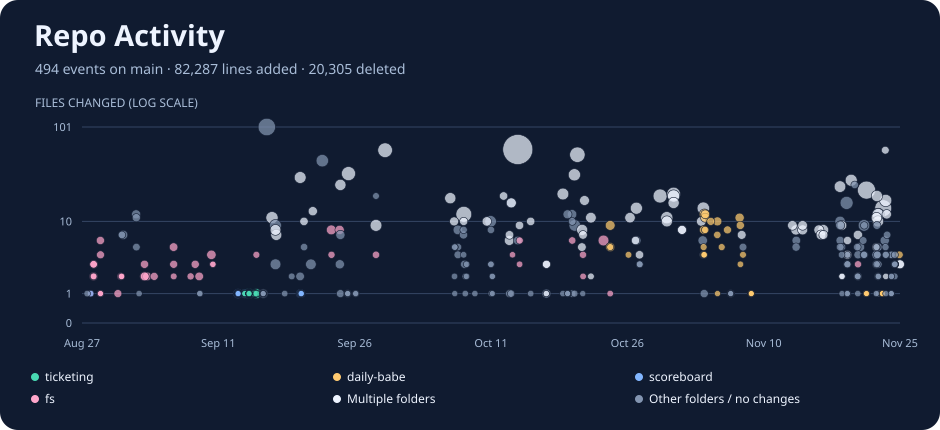

<!--
File Name     : README.md
Author        : Jason Lamb (with help from ChatGPT)
Description   : Repository overview, development conventions, project index, and deployment guidance.
Revision      : 1.1.0
Created Date  : 2025-02-14
Modified Date : 2026-11-25
Changelog     :
  Rev 1.1.0 - Generate project tables from per-project metadata.
  Rev 1.0.22 - Embed the repository activity plot and link the generated commit logs.
  Rev 1.0.21 - Link the searchable Jasr.me Project Navigation page.
  Rev 1.0.19 - Upgrade Fake Chatbot to PHP-backed joke portal with optional shared-identity history linking and admin tools.
  Rev 1.0.20 - Refresh Coin Flip and Super Tic-Tac-Toe documentation and screenshots.
  Rev 1.0.18 - Add preserved PowerShell fake chatbot and safe browser-based simulation as a new project.
  Rev 1.0.17 - Add Super Tic-Tac-Toe to the project index.
  Rev 1.0.16 - Link the Investment Tracker project title directly to its hosted Jasr.me site and clarify access requirements.
  Rev 1.0.15 - Add Kingdom Connections Christian business directory.
  Rev 1.0.14 - Reorganized the project index into readable groups and fixed its broken table formatting.
  Rev 1.0.13 - Corrected the Khootish rename history and linked the preserved deployment safety TODO.
  Rev 1.0.12 - Added preview-first full-report Robinhood import with atomic eligible-symbol batch and exception queue.
  Rev 1.0.11 - Added private staged Robinhood import with per-stock corrections, verified split/sale allocations and guarded persistence.
  Rev 1.0.10 - Documented Robinhood CSV preview and reconciled NVIDIA demo without committing personal brokerage files.
  Rev 1.0.9 - Clarified Investment Tracker's read-only NVIDIA demo and original/split-adjusted lot history.
  Rev 1.0.8 - Indexed authenticated Investment Tracker with tax-lot history and private CSV import.
  Rev 1.0.7 - Added Coin Flip to the project index.
  Rev 1.0.6 - Set regular merge commits as the default for preserving PR commit history.
  Rev 1.0.5 - Clarified exact-name config examples, protected placeholders and optional opt-in AI fallback.
  Rev 1.0.4 - Indexed Workout Tracker with key-free quick entry.
  Rev 1.0.3 - Linked the compiled project TODO list.
  Rev 1.0.2 - Added Build Signal source, revision notes, and illustration manifest for Codex CLI visual iteration.
  Rev 1.0.1 - Listed Khootish and Quiz Web Interactive as separate projects; marked the unavailable Quiz Web Interactive source path without substituting another app.
  Rev 1.0.0 - Added framework-first development requirements and complete folder inventory; corrected the stale quiz path. Earlier unversioned history remains in Git.
-->
# Website Stuff

This repo is where I keep HTML, CSS, JavaScript, PHP scripts, and small hosted web projects. I started my own website back in 2004 and have created a ton of code since then. It is all somewhere on my website, which is exactly how personal web projects reproduce in the wild.

I currently use Hostinger for hosting. I have used GoDaddy, billable through LuckyRegister, and Powweb before that. I currently maintain several domains, but I mainly publish on [jasonlamb.me](https://jasonlamb.me). I use [jasr.me](https://jasr.me) for tools, tests, redirects, and hosted side projects.

Important hosting note: this repo is used as source storage and syncs to my web host. PHP projects in this repo are intended to run from the hosted website, not from GitHub Pages.

## Repo activity

Each dot represents a commit or PR merge that landed on `main`. Time runs left to right. Height shows files changed on a logarithmic scale, size shows lines added plus deleted, and color identifies active folders. The window ends at the most recent commit in the charted history.

- [Download per-commit CSV](https://raw.githubusercontent.com/jasrasr/website/repo-activity/commit-activity.csv) for individual commits and their first-parent diffs.
- [Download main activity CSV](https://raw.githubusercontent.com/jasrasr/website/repo-activity/main-activity.csv) to count work once when it lands on `main`. Use this CSV for totals. It counts binary and renamed files as changed files and measures additions and deletions on text diffs.

The [Repo Activity workflow](https://github.com/jasrasr/website/actions/workflows/repo-activity.yml) (revision 1.0.0, 2026-11-25) publishes these files to the `repo-activity` branch after pushes to `main`. It also supports manual runs. A rerun with identical outputs leaves the snapshot as it is.

To preview locally, run `python3 .github/scripts/repo-activity.py /tmp/repo-activity` from a full checkout of the branch you want to measure. Compare the CSV row count (excluding the header) to `git rev-list --count HEAD`, compare the main CSV to `git rev-list --first-parent --count HEAD`, and open the SVG.

## Development conventions — read before changing files

Before creating or changing a project, read [the framework overview](1-Framework/README.md), [AI development instructions](1-Framework/AI-INSTRUCTIONS.md), [framework roadmap](1-Framework/ROADMAP.md), and the relevant project/module documentation. Inspect existing components before building another implementation.

These repository-wide requirements apply to new work and updates:

- Put a native file-type comment header at the top of every new or modified source/document file. Include **File Name, Author, Description, Revision, Created Date, Modified Date, and Changelog**. Use **Jason Lamb (with help from ChatGPT)** as the author and `YYYY-MM-DD` dates.
- Give each file an independent revision starting at `1.0.0`. Increment only changed files, preserve the original created date, update the modified date, and retain prior file changelog entries.
- Keep a cumulative project changelog, a project revision, and a visible revision/updated date on the application's main page. Record functional changes when they are made, rather than adding this documentation afterward.
- Keep strict data formats valid: JSON uses a leading `_header` metadata object instead of comments; binary assets use supported native metadata or an accompanying documented manifest.
- Include configuration examples without secrets, input/failure handling, and appropriate tests or a concrete manual validation procedure for functional changes.
- Reuse applicable framework components. New account-based PHP projects use the shared user-management provider through `SharedIdentity::connect()`; introducing another account store requires an explicit design decision.
- For host-only settings use `config.local.example.php` → `config.local.php`: remove **only `.example`** on Hostinger, not another section of the filename. Track safe `.placeholder` files for ignored runtime directories with explicit `.gitignore` exceptions; document files the application auto-creates versus secrets copied manually. Never commit credentials.
- If a no-key parser is backed by an optional external AI provider, keep local entry as default and show an explicit **Retry with AI** option when parsing is uncertain; never send text or save AI suggestions automatically.
- Use **Create a merge commit** by default for authorized GitHub PR merges to preserve original commits and authorship (including individual AI-tool changes). Squash/rebase only when explicitly requested. Follow `1-Framework/AI-INSTRUCTIONS.md` for the complete policy.
- Preserve existing saves, permissions, ignored runtime data, and deployment behavior. Document compatibility or migration needs. For Jason-requested PR changes, prepare the result for review and obtain explicit confirmation before merging.
- Update this project index when folders are added, renamed, or removed. Verify paths against the repository; identify placeholders and test/support folders, and do not imply an unverified deployment is live.

Apply framework components according to the project's runtime. Browser-only/offline projects such as Oregon Trail follow the documentation, revision, validation, and compatibility requirements without adding a PHP dependency solely to match the server-side framework. Its browser-local saves remain separate from server-side JSON storage.

## Primary sites

- Personal blog/site: [jasonlamb.me](https://jasonlamb.me)
- Tools, tests, redirects, and projects: [jasr.me](https://jasr.me)

## URL convention

Folders in this repo sync under `https://jasr.me/github/<folder>/`, which is the canonical URL for each project. Short vanity paths like `jasr.me/mpg` or `jasr.me/time-clock` are **redirects** to the matching `jasr.me/github/<folder>/` location, so the tables below list the canonical `/github/` URLs. Canonical `/github/` links open in a new tab.

## Project index

Open [Project Navigation](https://jasr.me/github/projects/) for a searchable tile view of featured projects. See [projects/](projects/) for its source and [README](projects/README.md) for maintenance and deployment.

Add or update a folder’s `project.json` to update its listing. See the [project metadata guide](projects/README.md#register-a-project).

Browse the projects by purpose. The source links open folders in this repository; site links may be live, private, or deployment targets. This index does not verify every hosted endpoint.

The [repository-wide TODO list](ALL-TODOS.md) collects the TODO files kept in each project folder. The [deployment safety TODO](DEPLOYMENT-SAFETY-TODO.md) retains Hostinger follow-ups from the former `quiz-web-interactive` folder.

[Games and interactive projects](#games-and-interactive-projects) · [Personal and group trackers](#personal-and-group-trackers) · [Tools and dashboards](#tools-and-dashboards) · [External services](#external-services)

### Games and interactive projects

<!-- BEGIN GENERATED README games -->
| Project and source | Site | Highlights |
| --- | --- | --- |
| **Build Signal walkthrough** [`build-signal/`](build-signal/) / [README](build-signal/README.md) | [Private ChatGPT Site](https://jason-ai-build-flow.jasrasr.chatgpt.site) | Illustrated AI development walkthrough. Linked ChatGPT Site is owner only. |
| **Super Tic-Tac-Toe** [`super-tic-tac-toe/`](super-tic-tac-toe/) / [README](super-tic-tac-toe/README.md) | [jasr.me/super-tic-tac-toe](https://jasr.me/super-tic-tac-toe/) | Nine linked boards, classic modes, local two-player or computer play, undo and redo, and optional private score history. |
| **Matching Game** [`matching-game/`](matching-game/) / [README](matching-game/README.md) | [jasr.me/github/matching-game](https://jasr.me/github/matching-game/) | Touch-friendly color memory game with custom grids, a timer, session scores, and optional private history. |
| **Feed the Pet** [`feed-the-pet/`](feed-the-pet/) / [README](feed-the-pet/README.md) | [jasr.me/github/feed-the-pet](https://jasr.me/github/feed-the-pet/) | Touch-friendly pet feeding game for young children with pet choice, food tapping, and simple progress. |
| **Coin Flip** [`coin-flip/`](coin-flip/) / [README](coin-flip/README.md) | [jasr.me/github/coin-flip](https://jasr.me/github/coin-flip/) | Giant animated coin, random heads or tails, keyboard control, and confetti. |
| **Game Buzzer** [`game-buzzer/`](game-buzzer/) / [README](game-buzzer/README.md) | [jasr.me/github/game-buzzer](https://jasr.me/github/game-buzzer/) | Six-team phone buzzer and arrival-survey Majority Rules game, with host controls and projector scoreboard. Requires private host setup. |
| **Live Game Scoreboard** [`scoreboard/`](scoreboard/) / [README](scoreboard/README.md) | [jasr.me/github/scoreboard](https://jasr.me/github/scoreboard/) | PHP scoreboard app with default, Collide, Youth, and Frontlines instances. |
| **Khootish Multiplayer Quiz** [`khootish/`](khootish/) / [README](khootish/README.md) | [jasr.me/github/khootish](https://jasr.me/github/khootish/) | Formerly `quiz-web-interactive` (renamed August 2026). Team quizzes with a projector display, question bank, and game history. |
| **Robot or Human? Verification Gate** [`human-proof/`](human-proof/) / [README](human-proof/README.md) | [jasr.me/github/human-proof](https://jasr.me/github/human-proof/) | Press-and-hold verification gate with optional PHP protection. |
| **Odometer / Speedometer** [`odometer/`](odometer/) | [jasr.me/github/odometer](https://jasr.me/github/odometer/) | Browser odometer/speedometer display (HTML/CSS/JS). |
| **Countdown to Cooper Integration** [`countdown/`](countdown/) | [jasr.me/github/countdown](https://jasr.me/github/countdown/) | Branded countdown timer page with Cooper and Altronic logos. |
| **Random URL / QR Targets** [`random-url/`](random-url/) | [jasr.me/github/random-url](https://jasr.me/github/random-url/) | Numbered static landing pages (`0.html`-`9.html`) used as QR-code targets, generated by a PowerShell script. |
| **Oregon Trail** [`oregon-trail/`](oregon-trail/) / [README](oregon-trail/README.md) | [jasr.me/github/oregon-trail](https://jasr.me/github/oregon-trail/) | Browser trail game with separate journey saves, autosaves, configurable stops/actions/events, and cached offline play. |
| **Magic Word Terminal** [`magic-word/`](magic-word/) | [jasr.me/github/magic-word](https://jasr.me/github/magic-word/) | Jurassic Park-inspired interactive access-denied terminal with command entry and sound. |
| **Random Wheel** [`wheel/`](wheel/) | [jasr.me/github/wheel](https://jasr.me/github/wheel/) | Editable random-choice wheel with a winner display and recent results. |
| **Construction Sign Generator** [`construction-sign/`](construction-sign/) / [README](construction-sign/README.md) | [jasr.me/github/construction-sign](https://jasr.me/github/construction-sign/) | Client-side LED message-board preview with adjustable appearance and image/embed export. |
| **Jeremy's Trip to Cleveland** [`jeremy/`](jeremy/) | [jasr.me/github/jeremy](https://jasr.me/github/jeremy/) | Trip progress and map pages for the California-to-Cleveland journey. |
<!-- END GENERATED README games -->

### Personal and group trackers

<!-- BEGIN GENERATED README trackers -->
| Project and source | Site | Highlights |
| --- | --- | --- |
| [**Investment Tracker**](https://jasr.me/github/investment-tracker/) [`investment-tracker/`](investment-tracker/) / [README](investment-tracker/README.md) | [jasr.me/github/investment-tracker](https://jasr.me/github/investment-tracker/) | Authenticated investment tracker with tax lots, split history, Robinhood imports, charts, and sell simulations. Project access required. |
| **Workout Tracker** [`workout-tracker/`](workout-tracker/) / [README](workout-tracker/README.md) | [jasr.me/github/workout-tracker](https://jasr.me/github/workout-tracker/) | Private fitness logging and trend charts. Requires central project access. |
| **Availability Poll** [`availability/`](availability/) / [README](availability/README.md) | [jasr.me/github/availability](https://jasr.me/github/availability/) | Named availability polls with admin-selected dates, private admin links, and live group results. |
| **MPG Fuel Log Tracker** [`mpg/`](mpg/) / [README](mpg/README.md) | [jasr.me/github/mpg](https://jasr.me/github/mpg/) | PHP fuel log with MPG calculations, CSV export, admin dashboard, and trend chart. |
| **Trip ETA Tracker** [`gps-eta/`](gps-eta/) / [README](gps-eta/README.md) | [jasr.me/github/gps-eta](https://jasr.me/github/gps-eta/) | Mobile GPS speed, ETA, compass heading, trip sessions, and server-side history. |
| **Family GPS Tracker** [`family-tracker/`](family-tracker/) / [README](family-tracker/README.md) | [jasr.me/github/family-tracker](https://jasr.me/github/family-tracker/) | Consent-based PHP + JSON family/friend location sharing with groups, check-ins, trip sharing, geofences, and installable PWA support. |
| **TV Binge Board** [`tv-binge-board/`](tv-binge-board/) / [README](tv-binge-board/README.md) | [jasr.me/github/tv-binge-board](https://jasr.me/github/tv-binge-board/) | Mobile-first PHP/JSON tracker for what to watch, watching, and completed TV/movies, with import, sharing, and friend activity. Does not stream. |
| **Budget Tracker** [`finances/`](finances/) / [README](finances/README.md) | [jasr.me/github/finances](https://jasr.me/github/finances/) | Private PHP budget tracker using per-user JSON files. |
| **License Plate Photo Logger** [`license-plate/`](license-plate/) / [README](license-plate/README.md) | [jasr.me/github/license-plate](https://jasr.me/github/license-plate/) | PHP app for uploading plate photos, extracting plate text, and logging duplicates. |
| **Timeclock Photo Logger** [`how-much-time-worked/`](how-much-time-worked/) / [README](how-much-time-worked/README.md) | Target folder: `/timeclock/` | Photo/manual employee hour logger with OCR options and JSON stats. |
| **Daily Babe Photo Tracker** [`daily-babe/`](daily-babe/) / [README](daily-babe/README.md) | [jasr.me/github/daily-babe](https://jasr.me/github/daily-babe/) | Private family photo galleries, memberships, and collage/GIF exports. Requires PHP and protected storage. |
| **Debt Payoff Planner** [`debt-payoff/`](debt-payoff/) / [README](debt-payoff/README.md) | [jasr.me/github/debt-payoff](https://jasr.me/github/debt-payoff/) | Per-user loan tracking, amortization, snowball/avalanche comparisons, sharing, and backups. |
| **Life Group Attendance** [`life-group-attendance/`](life-group-attendance/) / [README](life-group-attendance/README.md) | [jasr.me/github/life-group-attendance](https://jasr.me/github/life-group-attendance/) | Authenticated multi-group attendance, student profiles, leader approvals, and history. |
| **Warranty Tracker** [`warranty-tracker/`](warranty-tracker/) / [README](warranty-tracker/README.md) | [jasr.me/github/warranty-tracker](https://jasr.me/github/warranty-tracker/) | Private/shared household warranty records, expiration tracking, and account setup; uses the sibling framework. |
| **Refill Tracker** [`refill-tracker/`](refill-tracker/) / [README](refill-tracker/README.md) | [jasr.me/github/refill-tracker](https://jasr.me/github/refill-tracker/) | Household consumable inventory, storage locations, and restock planning. |
<!-- END GENERATED README trackers -->

### Tools and dashboards

<!-- BEGIN GENERATED README tools -->
| Project and source | Site | Highlights |
| --- | --- | --- |
| **Kingdom Connections** [`kingdom-connections/`](kingdom-connections/) / [README](kingdom-connections/README.md) | [jasr.me/github/kingdom-connections](https://jasr.me/github/kingdom-connections/) | Standalone Christian business directory with local accounts, business profiles, and payment-verified customer reviews. |
| **Webstats** [`webstats/`](webstats/) / [README](webstats/README.md) | [jasr.me/github/webstats](https://jasr.me/github/webstats/) | Custom multi-site page views and clicks with a private dashboard. Requires setup and tracker installation. |
| **Random Password Generator** [`random-password-generator/`](random-password-generator/) | [jasr.me/pw](https://jasr.me/pw) | Client-side password generator experiments and working copies. Deployed at `/pw`; the `/github/` path is access-restricted. |
| **Text Copy / scratch pad** [`text/`](text/) / [README](text/README.md) | [jasr.me/github/text](https://jasr.me/github/text/) | Server-backed scratch pad for editing text and retrieving it from another device. |
| **Time Clock Kiosk Display** [`time-clock/`](time-clock/) / [README](time-clock/README.md) | [jasr.me/github/time-clock](https://jasr.me/github/time-clock/) | Full-screen clock, weather, and scrolling alerts for a Raspberry Pi CM4 kiosk. |
| **Weather Dashboard** [`weather/`](weather/) / [README](weather/README.md) | [jasr.me/github/weather](https://jasr.me/github/weather/) | Mobile-friendly PHP weather dashboard using OpenWeather data. |
| **QR Box Inventory System** [`box/`](box/) / [README](box/README.md) | [jasr.me/github/box](https://jasr.me/github/box/) | Database-free QR inventory system for physical storage boxes. |
| **Very Fake AI Portal** [`fake-chatbot/`](fake-chatbot/) / [README](fake-chatbot/README.md) | [jasr.me/github/fake-chatbot](https://jasr.me/github/fake-chatbot/) | PHP/JsonStore joke chatbot with scored phrase/keyword rules, stored anonymous questions, optional shared-account history linking, and protected rule editor. No AI API. Original PowerShell script preserved in `legacy/`. Deployment pending merge/sync. |
| **AI Writing Tool** [`ai-writing-tool/`](ai-writing-tool/) / [README](ai-writing-tool/README.md) | [jasr.me/github/ai-writing-tool](https://jasr.me/github/ai-writing-tool/) | Two-pane browser editor with local autosave and AI suggestions through a PHP proxy. |
| **Secure Upload &amp; File Manager** [`file-manager/`](file-manager/) / [README](file-manager/README.md) | [jasr.me/github/file-manager](https://jasr.me/github/file-manager/) | Admin-only file manager with PowerShell-friendly upload API, MFA, allowlisting, and versioning. |
| **PSNotify** [`psnotify/`](psnotify/) / [README](psnotify/README.md) | [jasr.me/github/psnotify](https://jasr.me/github/psnotify/) | Self-hosted notification endpoint and viewer for long-running PowerShell jobs. |
| **Computer Heartbeat Dashboard** [`computers/`](computers/) / [README](computers/readme.md) | Target folder: `/computers/` | PowerShell-to-PHP heartbeat system for Windows device status tracking. |
| **JSON Flat-File Blog** [`blog/`](blog/) / [README](blog/README.md) | [jasr.me/github/blog](https://jasr.me/github/blog/) | Static-ish JSON blog with PowerShell builder, RSS, sitemap, and admin-protected media workflow. |
| **Visual Ping Webhook API** [`visual-ping-webhook-api/`](visual-ping-webhook-api/) / [README](visual-ping-webhook-api/README.md) | [jasr.me/github/visual-ping-webhook-api](https://jasr.me/github/visual-ping-webhook-api/) | Webhook API for Visual Ping. Early/placeholder. |
| **Dell Service Tag Lookup** [`dell-service-tag/`](dell-service-tag/) | [jasr.me/github/dell-service-tag](https://jasr.me/github/dell-service-tag/) | Service-tag entry page that opens the matching Dell Support page. |
| **Freshservice Ticket Tracker** [`fs/`](fs/) / [README](fs/README.md) | [jasr.me/github/fs](https://jasr.me/github/fs/) | Aggregate backlog and ticket activity charts with server-side API collection and ticket review tools. Requires private configuration. |
| **Ticketing** [`ticketing/`](ticketing/) / [README](ticketing/README.md) | [jasr.me/github/ticketing](https://jasr.me/github/ticketing/) | PHP/JSON requester and agent help-desk portals, categories, and CSV tools; preserve instance-local runtime data. |
| **Shared User Management** [`user-management/`](user-management/) / [README](user-management/README.md) | [jasr.me/github/user-management](https://jasr.me/github/user-management/) | Central accounts, same-host sessions, project roles, and an explicit per-application migration process. |
| **AI Model Release Timeline** [`ai-model-timeline/`](ai-model-timeline/) / [README](ai-model-timeline/README.md) | [jasr.me/ai-model-timeline](https://jasr.me/ai-model-timeline/) | Source-linked, versioned model release table and deterministic SVG/PNG timeline. |
<!-- END GENERATED README tools -->

### External services

| Project and source | Site | Highlights |
| --- | --- | --- |
| **YOURLS link shortener and tracker** External app | [jasr.me](https://jasr.me) | Fork of [YOURLS](https://github.com/YOURLS/YOURLS). |
| **Secure text sender** External app | [jasr.me/secure](https://jasr.me/secure) | Fork of [PrivateBin](https://github.com/PrivateBin/PrivateBin). |

## Repo support tools and standalone files

| Tool / file | Repo path / docs | Purpose |
|---|---|---|
| Smart 404 | [smart-404/](smart-404/) / [README](smart-404/README.md) | YOURLS-aware 404 handling, request logging, manual mappings, and conservative fuzzy matching. |
| Custom Directory Browser | [custom-directory/](custom-directory/) / [README](custom-directory/README.md) | Central path-aware PHP file browser using thin `directory.php` wrappers. |
| Standalone authenticated directory viewer | [Custom-HTML-Directory-Viewer.php](Custom-HTML-Directory-Viewer.php) | Generic authenticated file browser with favorites, telemetry, sorting, and download tracking. |
| Impossible Click | [impossible-click.html](impossible-click.html) | Standalone browser experiment/game. |
| Countdown (alt) | [countdown1.html](countdown1.html) | Standalone "Count to Integration with Cooper" countdown page. |
| Links | [links.html](links.html) | Standalone links page. |
| Old Phone Dialer | [phone-dialer.html](phone-dialer.html) | Standalone old-phone DTMF tone number pad experiment. |
| Screen Size | [screensize.php](screensize.php) | Live display of the current browser viewport size, updating on resize/zoom. |
| Shared Framework | [1-Framework/](1-Framework/) / [README](1-Framework/README.md) / [AI instructions](1-Framework/AI-INSTRUCTIONS.md) | Shared PHP/JSON infrastructure and development conventions; review before starting work. |
| Repository automation | [.github/](.github/) | GitHub Actions workflows for validation, publishing, and deployment notifications. |
| Demo screenshots | [demo/](demo/) / [README](demo/README.md) | Captured project screenshots; supporting assets rather than a separate app. |
| Webstats demo | [webstats-demo/](webstats-demo/) | Example pages for exercising the Webstats tracker. |
| Test projects | [testing/](testing/) / [Youth Scoreboard test docs](testing/CVC-Youth-Scoreboard/README.md) | Experimental/test copies; do not assume production status. |
| Linktree placeholder | [linktree/](linktree/) / [README](linktree/README.md) | Documentation-only placeholder; planned implementation files are not present. |

## Deployment notes

- GitHub stores source files.
- Hostinger runs the PHP projects.
- Short paths like `jasr.me/<project>` redirect to the canonical `jasr.me/github/<folder>/`.
- Runtime files such as logs, private config, API keys, uploaded files, and generated JSON data should stay out of Git unless they are public-safe samples.
- Project-specific setup instructions live in the project README files linked above.

## Shared user management

[`user-management`](user-management/README.md) provides central accounts, same-host login and per-project access roles. [`1-Framework`](1-Framework/README.md) now exposes its configured integration through `SharedIdentity::connect()`. Existing projects can adopt it individually after mapping their users and protecting their PHP endpoints.

Track shared-login adoption in the [User Management migration tracker](user-management/MIGRATION-TRACKER.md). Each application has its own migration checklist; completion requires verified data preservation and live access checks.

### AI Model Release Timeline

- [AI Model Timeline](https://jasr.me/ai-model-timeline/) — source-linked, versioned model release table and deterministic SVG/PNG timeline. [Project files](ai-model-timeline/) · [Historical graphics](ai-model-timeline/archive/manifest.json)
