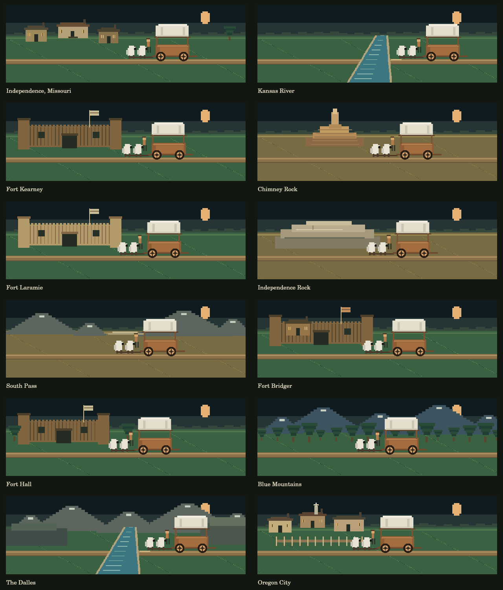

<!--
File Name     : README.md
Author        : Jason Lamb (with help from ChatGPT)
Description   : Project usage, content editing, saves, illness weights, revisions, and validation.
Revision      : 1.0.1
Created Date  : 2026-10-08
Modified Date : 2026-10-19
Changelog     :
  Rev 1.0.1 - Documented framework alignment and repository-wide development requirements.
  Rev 1.0.0 - Established independent file revision tracking; Project usage, content editing, saves, illness weights, revisions, and validation.
-->
# Oregon Trail

A small browser game, with automatic device-local saves and editable game content.

## Framework alignment

Before changing this project, read the repository [development conventions](../README.md#development-conventions--read-before-changing-files), [framework overview](../1-Framework/README.md), [AI development instructions](../1-Framework/AI-INSTRUCTIONS.md), and [framework roadmap](../1-Framework/ROADMAP.md). Functional changes require documentation, configuration/failure handling, a changelog entry, and automated checks or a concrete manual validation procedure. Preserve file headers and independent file revisions.

Oregon Trail is a standalone browser/offline application. It follows applicable framework conventions while using browser-local saves and cached frontend modules; the server-side PHP JsonStore and authentication provider are not runtime dependencies. New server-backed accounts or cross-device saves should evaluate the existing shared identity/storage components before adding another implementation.

## Your travelers

New journeys suggest a randomized family of five: you and another adult aged 30–50, plus three children aged 1–17 (at least 18 years younger than both adults). Other travelers have distinct randomly chosen names. All names and ages can be edited; manual ages remain 1–90, so older relatives can join. The suggested family changes only when creating a new journey; reloads preserve the saved party.

Select the PARTY card to open the traveler roster. It lists each person's name, age, health, illness, and whether they remain with the party. Deceased travelers stay in the roster with their cause of death, trail date, and mileage. Inspecting the roster pauses auto-play and does not advance a turn. Close the roster to return to the same choice; resume auto-play explicitly if desired.

Party health is the rounded average of surviving travelers' individual health. Illness affects one living traveler, selected by age-weighted susceptibility. Rest, starvation, normal recovery, and other configured health effects apply to each living traveler. Recovery to 100 health clears illness; zero health records death. Deceased travelers never heal.

Existing saves migrate their surviving names and ages, using saved party health as the initial individual health. They show a note that earlier individual conditions and previously lost travelers are unavailable. New roster data is included in automatic saves. Old saves are not randomized.

## Revisions and illness susceptibility

Project Rev 1.0.0 (2026-10-19) is the first explicitly numbered revision, currently under review in PR #113. The main page displays the project revision/date from `version.js` and links to the cumulative `CHANGELOG.md`. File revisions are independent and begin at 1.0.0 when the preferred header is introduced.

Illness frequency is still `events[].chancePercent` (9% per travel turn by default). When illness occurs, selection among surviving travelers uses the `illnessRisk` configuration. Defaults:

- Ages 12–50: weight 1.0.
- Below 12: add 0.1 per year younger. Age 1 has weight 2.1.
- Above 50: add 0.05 per year older. Age 60 has weight 1.5; age 80 has weight 2.5.
- Weights are capped at 3.0. This is a game-balancing rule, not a medical estimate.

A weight of 2 means twice the selection likelihood of a weight-1 traveler when an illness event occurs. It is not a 2% chance each turn. The roster displays each living traveler's relative susceptibility. Existing save snapshots without an illnessRisk field use these defaults; saves with a field retain their configured settings.

All source/document files carry the preferred comment header. JSON uses a leading `_header` object; the PNG preview uses native PNG Comment metadata so both remain valid files.

## Saved journeys and recovery

- Packing the wagon creates a separate saved journey.
- Every completed action saves immediately, including the exact pending river or landmark choice. Reloading resumes the most recently saved unfinished journey without rerolling the last turn.
- "Start a new journey" keeps the existing journey. Open "Saved journeys on this device" to continue an older game or view a completed one.
- Saves include the party, date, supplies, health, miles, pace, rations, next stop, story, pending choice, and a snapshot of the content rules.
- Saves use browser localStorage on the current origin. They do not sync across devices, browsers, private windows, or domains. Clearing site data removes them. Storage failures appear on screen; unreadable data is not overwritten.
- Setup form drafts are not saved until the wagon is packed.
- Offline play and reload become available once the service worker successfully installs over HTTPS (or localhost). Wait for "Ready for offline play on this device." The initial visit needs connectivity. External fonts are optional; system fonts work offline.
- Active journeys retain their original rules. Content edits apply to new journeys after reloading the page.
- When changing app code, increment the cache version in `sw.js`. Close old game tabs and reopen to activate an updated worker.

## Scenery

Each built-in stop has a pixel-art scene: distinct forts, Chimney Rock, Independence Rock, South Pass, Blue Mountains, The Dalles, and Oregon City. Rivers cut across the horizontal road with the westbound wagon waiting on the right bank. The location caption follows the current stop; while traveling it says which stop lies ahead.



A stop can set an optional `scene` in `game-content.json`: `prairie`, `settlement`, `fort`, `chimney`, `rock`, `pass`, `mountains`, `river`, `gorge`, or `town`. Set `type: "river"` for an actual crossing; artwork does not add crossing mechanics by itself. Old saved content without `scene` uses built-in IDs and stop types as a fallback. Scenery is rendered locally by canvas, consumes no gameplay random numbers, and works offline with the app.

To regenerate the preview, install `@napi-rs/canvas` locally and run `node oregon-trail/tools/render-scenes.cjs`.

## Edit stops, actions and probabilities

Edit [game-content.json](game-content.json). It is a plain-text JSON file; no JavaScript changes are required for the supported content below. JSON requires double quotes and does not allow comments or trailing commas. Bad content is reported without deleting saves; older saved journeys can still be opened with their embedded rules.

### Random travel events

`chancePercent` is an **absolute percentage per travel turn** (one week), not a relative weight. One event at most is selected. Event percentages must total 100 or less. The unused percentage is a quiet travel turn.

Defaults: wagon trouble 12%, illness 9%, food found 10%, quiet travel 69%. Zero disables an event. 100 makes a single event certain.

Add an object to `events`:

```json
{
  "id": "helpful-traveler",
  "chancePercent": 5,
  "title": "A traveler shares supplies.",
  "message": "There is still kindness on the trail.",
  "effects": { "food": [10, 25], "health": 3 }
}
```

With the default events unchanged, adding this 5% event leaves 64% quiet turns.

### Stops and actions

Add stops to `stops` in increasing mile order with unique IDs. `type` is `"stop"` or `"river"`. The final stop must be at `totalMiles`. Rivers use the configurable `crossings` choices. All crossed stops are offered in order, even when one travel turn passes more than one mile marker.

Example additional stop:

```json
{
  "id": "prairie-camp",
  "name": "Prairie Camp",
  "mile": 200,
  "type": "stop",
  "actions": [
    {
      "label": "Search for edible plants",
      "days": 1,
      "successPercent": 60,
      "message": "You find food for the journey.",
      "effects": { "food": [5, 20] },
      "failureMessage": "The search leaves the party tired.",
      "failureEffects": { "health": -3 }
    }
  ]
}
```

An action's `successPercent` is its own chance when selected; it does not contribute to travel-event percentages. If omitted, the action succeeds every time. `days` pass on both success and failure. Actions may be repeated at a stop; leaving the stop completes it. River crossing actions resolve the crossing and leave the stop.

The top-level `actions` list adds options to every trail camp. A stop's `actions` list adds options only at that stop.

Supported effects are `food` (pounds), `health` (points), and `miles`. Positive numbers add; negative numbers remove. An integer range such as `[5,20]` chooses inclusively between 5 and 20. `days` for custom actions can also be an integer range. Health is limited to 0–100; food and miles cannot go below zero. No code from JSON is executed. Health reaching zero ends the journey.

### Hunting and rivers

- `hunting.failurePercent`: chance that a hunting action finds nothing.
- `hunting.food`: inclusive food reward range.
- `hunting.days`: whole days spent hunting.
- `crossings[].successPercent`: chance each crossing method succeeds.
- `crossings[].days`: whole days spent crossing.
- `crossings[].costFood`: optional food cost, paid on either outcome; insufficient food disables that choice.
- `crossingFailure.foodLoss` and `milesLost`: inclusive loss ranges.
- `crossingFailure.travelerLossPercent`: chance of losing one traveler **conditional on a failed crossing**. For example, 40% safe with 25% traveler loss on failure means a 15% overall traveler-loss chance.

The ferry uses food as its cost because this game does not track money.

## Validation

Requires Node.js. The browser recovery test also requires Playwright and Chromium:

```sh
npm install --no-save playwright
npx playwright install chromium
node --test oregon-trail/tests/game.test.cjs
```

Run the rules, storage, runtime recovery, and service-worker tests without browser dependencies:

```sh
node --test oregon-trail/tests/*.test.cjs
```

To include the real Chromium recovery and offline reload test after installing Playwright and Chromium:

```sh
RUN_BROWSER_TESTS=1 node --test oregon-trail/tests/*.test.cjs
```

Tests cover probability boundaries, invalid content, month rollover, preserving separate journeys, unreadable storage, restored pace and river choices, and offline caching and saving. The real-browser test is opt-in.
