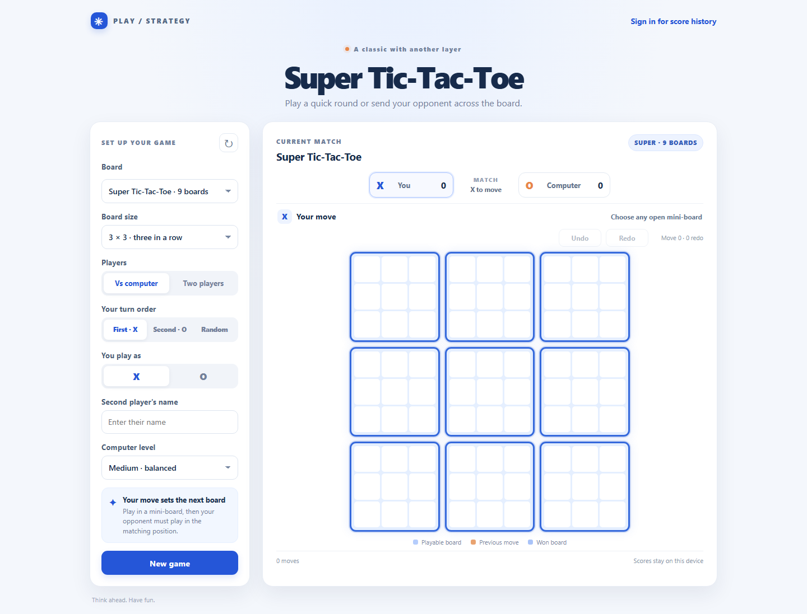
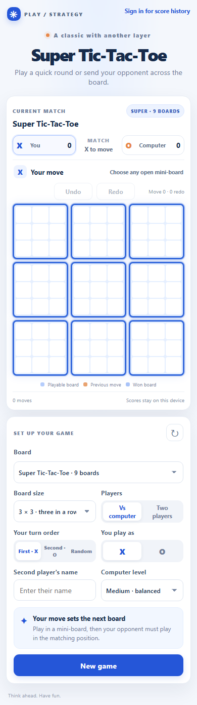

<!--
File Name: README.md
Author: Jason Lamb (with help from ChatGPT)
Description: Super Tic-Tac-Toe setup, gameplay, validation, and deployment.
Revision: 1.0.1
Created Date: 2026-11-19
Modified Date: 2026-11-22
Changelog: 1.0.1 - Add fresh desktop and mobile screenshots. 1.0.0 - Document the game and deployment.
-->
# Super Tic-Tac-Toe

**Play the game:** [Jasr.me](https://jasr.me/super-tic-tac-toe/)

Mobile-friendly game app built as a standalone PHP/JavaScript project using the shared `1-Framework` and optional `user-management` identity provider.

## Game modes

- **Super Tic-Tac-Toe:** nine 3×3 boards. Your cell position routes the next player to the corresponding mini-board. A completed mini-board cannot be played again; when the required board is complete, the next player may choose any available board. Three won mini-boards in a row wins the match.
- **Classic Tic-Tac-Toe:** choose a 3×3, 4×4, or 5×5 board. The player must connect the same number of marks as the board width.
- For computer matches, choose whether you play first as X, second as O, or let the game choose randomly. For two local players, enter the second player’s name and choose whether you play as X or O.
- Computer levels are Easy, Medium, and Hard, with Medium as the default. Hard uses bounded lookahead for Super Tic-Tac-Toe and 4×4/5×5 classic boards; it is a stronger search, not a guarantee of perfect play. Classic 3×3 Hard uses minimax.
- The most recent move and current playable board are highlighted. Winning cells and winning mini-boards are highlighted, with a full-screen winner overlay and a control to return to the board. Undo has no move-count limit during the current game; against the computer it steps back through the latest human/computer turn together. Redo replays undone moves up to the latest move. Starting a new game clears that game’s move history. Anonymous visitors can play without an account.

## User-management score history

The game does not create or manage accounts. It uses `Jasr\Framework\SharedIdentity::connect()` when the shared provider is available. To record history:

1. Deploy `1-Framework`, `user-management`, and this project beside each other on the same HTTPS host.
2. In User Management, register project ID `super-tic-tac-toe` at its deployed local path and grant the intended users **Member** access. A central user without this grant can still play, but their games will not be recorded.
3. Ensure `super-tic-tac-toe/data/` is writable by PHP and blocked from direct HTTP access. The included Apache/LiteSpeed rule denies JSON and lock files; configure an equivalent rule for nginx if needed.
4. Signed-in members can open **View score history** below the board to see aggregate wins, losses, draws, up to 50 recent results, the computer difficulty used, and the named local opponent when applicable. The latest saved game setup can be replayed from the history panel. Records are stored by stable central user ID in `data/scores.json`. Anonymous games stay in browser local storage and are not sent to the server. No gameplay moves or board contents are uploaded.

If user management is unavailable or not configured, the public game still works. History is private to the account and is read or changed only through the PHP API. Keep server backups and never commit runtime JSON files.

## Deployment

Upload the complete directory. Confirm that PHP 8.1+ is available and that `.htaccess` rules are honored. For nginx, configure a deny rule for `data/` and sensitive files. The app creates its score file on first recorded game; it does not create or alter user accounts.
